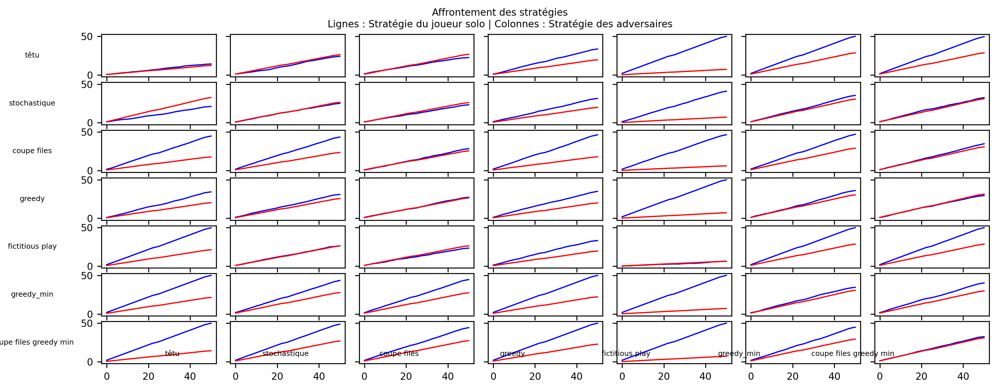

## Description des choix importants d'implémentation

### Class Joueur
1. **`__init__(self, player)`** : 
   Cette méthode initialise un joueur avec les attributs suivants :
   - `player` : l'objet Sprite représentant le joueur.
   - `path` : la liste des cases que le joueur doit parcourir pour atteindre son objectif.
   - `strat` : la stratégie utilisée par défaut (stratégie têtue et stochastique).
   - `choix_resto` : la liste des choix de restaurants pour certaines stratégies.
   - `cap_restos` : utilisé pour stocker les capacités des restaurants (uniquement pour la stratégie greedy_min).

2. **`set_strat(self, strat)`** :
   Permet de définir la stratégie que le joueur va utiliser. Elle lie dynamiquement la méthode de stratégie spécifiée à l'instance actuelle du joueur.

3. **`set_choix_resto(self, id_restaurant)`** :
   Cette méthode définit la liste des choix de restaurants en fonction de la stratégie. Elle prend en argument :
   - Une liste vide (`[]`) pour les stratégies stochastiques, fictitious play et coupe-files et définit une choix aléatoire.
   - Une liste contenant un seul élément (`[x]`) pour la stratégie têtue (où `x` représente un restaurant).
   - Une liste de plusieurs éléments (`[x0, x1, ..., xn]`) pour d'autres stratégies explorant plusieurs restaurants.

4. **`get_next_move(self)`** :
   Détermine le prochain déplacement du joueur. Si le joueur n'a pas encore de chemin assigné, il en génère un via la stratégie définie. Retourne la prochaine position.

5. **`get_path(self, pos_src, pos_dst)`** :
   Calcule et retourne le chemin le plus court entre une position source (`pos_src`) et une position destination (`pos_dst`) en utilisant l'algorithme A* (avec l'heuristique de Manhattan).

Enfin, cette classe contient toutes les stratégies. Centraliser nos joueurs et nos stratégies nous a permis de simplifier les échanges d'informations. Pour chaque stratégie nous avons accès à tous les attributs du joueur et le code est plus lisible et flexible.

###  journee:

Intègre la gestion des déplacements, interactions avec les objets du jeu, et le calcul des scores.

1. **Placement des coupe-files**
   - Les objets coupe-files sont placés aléatoirement sur la carte
  
2. **Placement des joueurs**
   - Tous les joueurs sont initialement placés aléatoirement sur la ligne du bas du plateau.

3. **Boucle principale des déplacements**
   - Cette boucle représente les déplacements des joueurs sur le plateau jusqu'à ce qu'ils atteignent leurs objectifs (restaurants). 
   - Le système suit les étapes suivantes :
     - Chaque joueur fait un mouvement calculé par sa stratégie (`get_next_move()`).
     - Une vérification est effectuée pour déterminer si le joueur a atteint son objectif.
     - Les joueurs peuvent ramasser des coupe-files s'ils tombent sur les positions correspondantes.
   - Une logique de double vérification est utilisée pour s'assurer que tous les joueurs sont satisfaits avant de terminer la journée.

4. **Calcul des scores**
   - À la fin de la journée, les scores sont calculés en fonction :
     - Du nombre de joueurs présents dans chaque restaurant.
     - Du service fourni par les restaurants.
   - Les scores journaliers sont retournés et utilisés pour évaluer les performances.

### main

Contient toute la logique nécessaire pour paramétrer les différentes composantes du jeu, gérer les journées, et "et permettre de sélectionner les stratégies prédéfinies.

- **Gestion des itérations et des journées**  
  La variable `iterations` contrôle le nombre maximum de pas par journée.  
  La variable `nb_days` définit le nombre total de journées dans la simulation.
  La variable `nb_update` détermine le nombre de mise à jour que l'on va faire pour fictitious play.
  La variable `nb_moyenne` qui définit le nombre de parties qu'on veut faire pour ces mêmes stratégies.  
  Une boucle `for` itère sur chaque journée et exécute la logique du jeu.

- **Les objets sur la carte**  
  - Les restaurants sont définis avec des positions fixes et une capacité initiale de 1.  
  - Les coupe-files sont collectés pour être utilisés dans des stratégies spécifiques.

- **Configuration des joueurs**  
  Crée une liste de joueurs et attribue à chacun une stratégie et un choix de restaurant.  
  - Les stratégies sont définies manuellement.

- **Simulation d'une journée**  
  À chaque journée, les positions des joueurs et les scores sont mis à jour.

## Description des stratégies proposées

- **strat_tetu**
Cette stratégie consiste à aller systématiquement dans le même restaurant à chaque itération. Le joueur ne change jamais sa destination, indépendamment des autres joueurs ou des événements environnants.
- **strat_stochastique**
Cette stratégie consiste à aller, à chaque itération, dans un restaurant aléatoire. Son choix de resturant est tiré selon une loi uniforme.
- **strat_greedy**
Cette stratégie suit un parcours des restaurants dans un ordre croissant (de 0 à `nb_restos - 1`). Si le seuil d'occupation (défini par la variable `seuil`) est dépassé pour un restaurant, le joueur passe au suivant. Si tous les restaurants sont testés sans succès, il reste sur place ou choisit une destination aléatoire.
- **strat_greedy_min**
Cette stratégie teste les restaurants dans l'ordre croissant comme dans la stratégie Greedy classique. Une fois tous les restaurants explorés, elle identifie le restaurant avec le moins d'occupation et s'y dirige. Si ce restaurant est déjà occupé de manière inattendue, la stratégie ré-évalue et adapte sa sélection. Le joueur se compte lui même.
- **strat_coupe_files**
Cette stratégie priorise la collecte d'un coupe-file avant de se diriger vers un restaurant. Le joueur se rend d'abord vers le coupe-file le plus proche (calculé avec la distance de Manhattan). Une fois le coupe-file acquis ou si aucun coupe-file n'est disponible, il se dirige vers un restaurant prédéterminé aléatoirement.
- **strat_coupe_files_greedy_min**
Cette stratégie combine l'acquisition de coupe-file et la logique de Greedy Min. Le joueur récupère d'abord un coupe-file (s'il est disponible), puis se dirige vers le restaurant ayant le moins d'occupation. Si tous les restaurants sont explorés, il applique le même raisonnement qu'une stratégie Greedy Min.
- **strat_fictitious_play**
Cette stratégie repose sur l'historique des fréquentations des restaurants. Le joueur analyse la fréquence historique des autres joueurs et choisit le restaurant le moins fréquenté. En cas d'égalité entre plusieurs restaurants, il fait un choix aléatoire parmi eux.

## Description des résultats

Pour analyser nos stratégies, nous les avons toutes fait s'affronter et nous avons rangé les résultats sous forme de graphique dans un grand graphique. Celui ci a été réalisé avec <code>nb_moyenne = 10</code>; <code>nb_update = 25</code>; <code>nb_days = 50</code> et un seuil fixé pour la stratégie greedy à <code>3</code>. Les stratégies ont été testée avec 1 joueur solo contre les 7 autres utilisant la même stratégie, sur le restaurant 2 (avec 2 coupe files).

On peut constater différentes choses: 
- **Courbe bleue**
La courbe bleue se trouve généralement au dessus de la courbe rouge. On en déduit donc que les stratégies implémentées sont plus individuelles que collectives.
- **Diagonale**
Sur la diagonale on voit que lorsque les 8 joueurs utilisent la même stratégie, ils minimisent pour eux tous leurs gains.
- **Coupe file**
Cettre stratégie est très intéressante étant donné le gain obtenu lors du calcul des scores. Elle fonctionne bien contre la plupart des stratégies (toutes celles basées sur les resturants).
- **Greedy**
Cette stratégie se démarque lorsque les adversaires sont mal repartit dans les restaurants (comme têtu par exemple). Ici les courbes sont très convaincantes, avec un seuil à deux on s'attendrait à des résultats nettement meilleurs.
- **Fictitious play**
Cette stratégie ne fonctionne pas du tout lorsque plusieurs joueurs l'utilisent en même temps. Par ailleurs en solo elle ne marche pas non plus lorsque les adversaires sont repartis uniformément dans les restaurants. On observe donc que la case fictitious play vs fictitious play est la pire du graphique. En revanche elle fonctionne bien contre têtu et par suprise aussi contre les stratégies greedy, greedy_min et coupe_files_greedy_min (qui reposent sur le même principe). Cela est du au fait que lorsque plusieurs joueurs se trouent dans un resturant, fictitious play ne va pas en sortir, ce qui lui laisse la place.
- **Greedy min**
On voit bien sur les deux dernières lignes que c'est la meilleure stratégie en solo atteignant à chaque fois presque les 100% de gains à la fin de la partie.

## Setup

Pour simuler des journées, rendez-vous dans le main.

Juste au dessus vous trouverez <code>os.environ["SDL_VIDEODRIVER"] = "dummy"</code> qu'il faudra mettre en commentaire si vous voulez avoir l'interface graphique et décomenter <code>game.mainiteration()</code> qui se trouve dans la deuxième boucle dans la fonction journee juste au dessus de la condition <code>if all(are_arrived)</code>. Si vous souhaitez juste effectuer plusieurs opérations laissez le code tel quel.

Entrez ensuite dans le main ou vous tomberez dans la fonction <code>init</code> sur la variable <code>game.fps</code> qui sert a modifier les fps de l'affichage graphique, réglez le selon vos préférences. (Attention, si vous avez décidé de ne pas afficher l'interface graphique en ne commentant pas <code>os.environ["SDL_VIDEODRIVER"] = "dummy"</code> vous ne verrez pas de différence).

Descendez légèrement et vous trouverez la variable <code>nb_days</code> (ainsi que <code>nb_moyenne</code> et <code>nb_update</code>) ou vous pourrez modifier le nombre de journées que vous voullez faire. Si l'interface graphique est activé, nous vous recommandons de n'afficher que très peu de journées, pour des parties de plus de 20 journées désactivez l'interface graphique.

Enfin, dans la boucle <code>for</code> des journées, juste en dessous de la déclaration de la liste <code>joueurs</code>, et juste avant la mise à jour des score <code>score_per_game</code>, vous trouverez ici les joueurs ainsi que leurs choix de resturant et de stratégie. Modifiez ces attributions comme bon vous semble. Pour chaque stratégie, il faut aller regarder dans la définition des stratégies (en haut, dans la classe Joueur) si la stratégie nécessite une déclaration particulière comme choix de resturants (Cela peut être un id de restaurant € [0, nb_restos-1], ou bien une liste d'id de restaurant telle qu'elle soit de taille nb_restos et où chaque élément de la liste est un id € [0, nb_restos-1] avec tous les id distincts (par exemple range(0, nb_restos))). Cette attribution manuelle est nécessaire pour pouvoir bien définir les paramètres des itérations que nous allons faire sur plusieurs journées, cela réduit le facteur aléatoire et nous obtenons des résultats plus déterministe.

